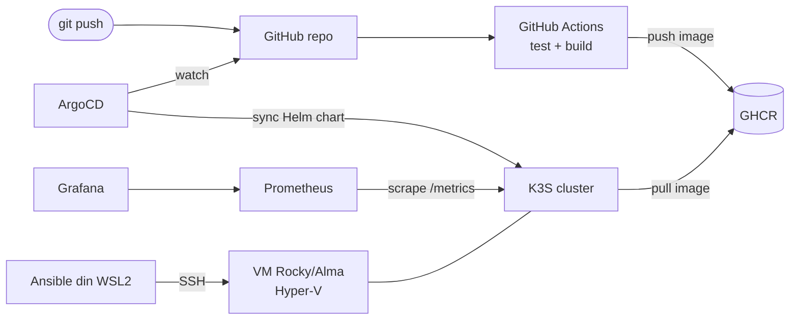

# DevOps Home Lab

Home lab construit de la zero ca să înțeleg (și să pot explica) un flux GitOps complet:
**GitHub Actions → GHCR → Helm → ArgoCD → K3S**, monitorizat cu **Prometheus + Grafana**,
cu infrastructura configurată prin **Ansible** și un pipeline paralel în **Jenkins** pentru comparație.

## Arhitectură

## Mediu

| Rol | Ce rulează |
|---|---|
| Workstation | Windows 11 + WSL2 Ubuntu 24.04 (6 GB RAM, 4 vCPU): Docker Engine, kubectl, Helm 4, gh, Ansible (pipx) |
| Cluster | VM Hyper-V Rocky/Alma Linux cu K3S (se creează la Faza 4) |

## Structură

| Folder | Conținut |
|---|---|
| `app/` | Aplicația (Flask/FastAPI cu `/health` și `/metrics`) + Dockerfile + teste |
| `charts/` | Chart-ul Helm al aplicației |
| `argocd/` | Manifestele `Application` pentru ArgoCD |
| `ansible/` | Inventory, playbook-uri și roluri pentru VM și K3S |
| `docs/` | `interviu.md`, `post-mortems.md`, note |

## Faze

- [x] 0. Mediul: WSL2, Hyper-V, Docker, kubectl, Helm, gh, Ansible
- [x] 1. Fundația: repo, structură, README
- [ ] 2. Aplicația + Dockerfile
- [ ] 3. GitHub Actions → GHCR
- [ ] 4. K3S + manifeste scrise de mână
- [ ] 5. Helm chart
- [ ] 6. ArgoCD (GitOps, auto-sync, self-heal)
- [ ] 7. Monitoring (kube-prometheus-stack, ServiceMonitor, dashboard, alertă)
- [ ] 8. Ansible: provisioning VM + K3S
- [ ] 9. Jenkins (opțional)
- [ ] 10. Incidente simulate + post-mortems

## Ce am învățat

### Faza 0–1: Mediul și repo-ul
- **WSL2 ca workstation, VM separată pentru cluster.** Ansible nu rulează ca control node pe Windows, deci WSL2 e obligatoriu. Cluster-ul stă pe o VM ca să am un "server" real, accesat prin SSH.
- **`.wslconfig` limitează RAM/CPU pentru WSL2.** Fără limite, WSL poate lua până la 50% din RAM și nu-l eliberează ușor.
- **Lucrez în `~`, nu în `/mnt/c`.** `/mnt/c` trece prin 9P (lent) și nu respectă `chmod`, iar SSH refuză cheile private cu permisiuni prea largi.
- **Supply chain la instalare:** repo apt oficial cu cheie GPG (`signed-by`), checksum `sha256` pentru binarul kubectl, scriptul Helm citit înainte de rulare (nu `curl | bash`).
- **Grupul `docker` = root pe mașină.** Acceptabil în lab; în producție aș folosi rootless Docker/Podman.
- **Modificările de mediu (grupuri, `PATH`) se aplică doar în sesiuni noi.** Cauză clasică de "la mine merge, în cron/CI nu".
- **Log-urile se filtrează după `level`, nu după cuvântul "error".** La pornire, Docker loghează `level=info ... error="No such file"` la ștergerea regulilor nftables inexistente: e zgomot, nu o problemă.
- **Tokenul gh e salvat în clar** în `~/.config/gh/hosts.yml` (nu există keyring în WSL). Fișierul are 600. În producție: token cu expirare / fine-grained PAT; în CI doar `GITHUB_TOKEN` efemer.
- **Scope-ul `workflow`** e necesar ca să poți face push la fișiere din `.github/workflows/` cu un token OAuth.
- **Email noreply GitHub** în `git config`, ca adresa reală să nu apară în istoricul unui repo public.
- **Git nu urmărește foldere goale**, de aceea fiecare folder are un `.gitkeep` până primește conținut.

## Greșeli făcute

- **`wsl --install` a instalat doar platforma, nu și distribuția.** După restart, `wsl -l -v` arăta "no installed distributions". Diagnostic: `wsl --version` (platforma OK), `wsl --list --online` (catalogul OK), deci lipsea doar distro-ul. Fix: `wsl --install -d Ubuntu-24.04`. Lecție: verifici fiecare componentă separat, nu doar exit code-ul installer-ului.
- **Primele comenzi le-am rulat din `/mnt/c/WINDOWS/system32`** (unde deschide WSL implicit din PowerShell admin). Am trecut în `~` înainte să apară probleme de permisiuni sau performanță.
